<div align="center">



⏱ **1 min read** &nbsp;·&nbsp; 🇨🇭 Switzerland &nbsp;·&nbsp; Open Source

</div>

---

## The New Work Way

I'm **roebi** — Robert Halter, Swiss software engineer with years of experience in test automation and CI/CD.

A while back I started asking: *what if the way we work with AI could be as structured and reusable as good code?*

That question led to **New Work with Skills** — a methodology where every task you give an AI agent is defined as a versioned, portable `SKILL.md` file. Not a vague prompt. A skill.

```
You don't prompt. You invoke a skill.
Skills are composable. Skills are auditable. Skills ship.
```

---

## How it works

**1. Define** — Write a `SKILL.md` that captures *what* the agent should do, *how*, and *when it's done*.  
**2. Invoke** — Any LLM agent reads the skill and executes it deterministically.  
**3. Compose** — Skills call other skills. Complex workflows from simple building blocks.  
**4. Version** — Pin skills like dependencies. Reproducible today, next year, on any model.

This is the [agentskills.io](https://agentskills.io) open specification — and I'm actively building on it.

---

## Where to go next

| | |
|---|---|
| 🌐 **[new-work-skills.dev](https://new-work-skills.dev)** | The methodology, skill cards, live examples |
| 📝 **[Blog](https://roebi.github.io/roebi-halter-in-blog)** | What I'm learning, building, and discovering |
| 🤖 **[agent-skills](https://github.com/roebi/agent-skills)** | My personal skills library — open source |
| 🛠 **[aider-skills](https://github.com/roebi/aider-skills)** | Agent Skills integration for aider |

---

<div align="center">

*roebi · Robert Halter · New Work with Skills · new-work-skills.dev · Switzerland*

</div>
